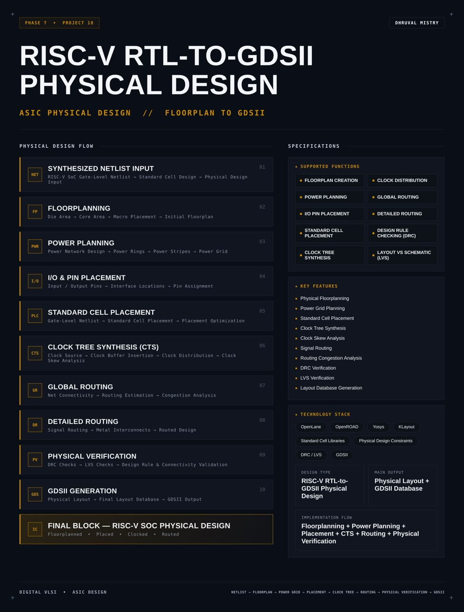
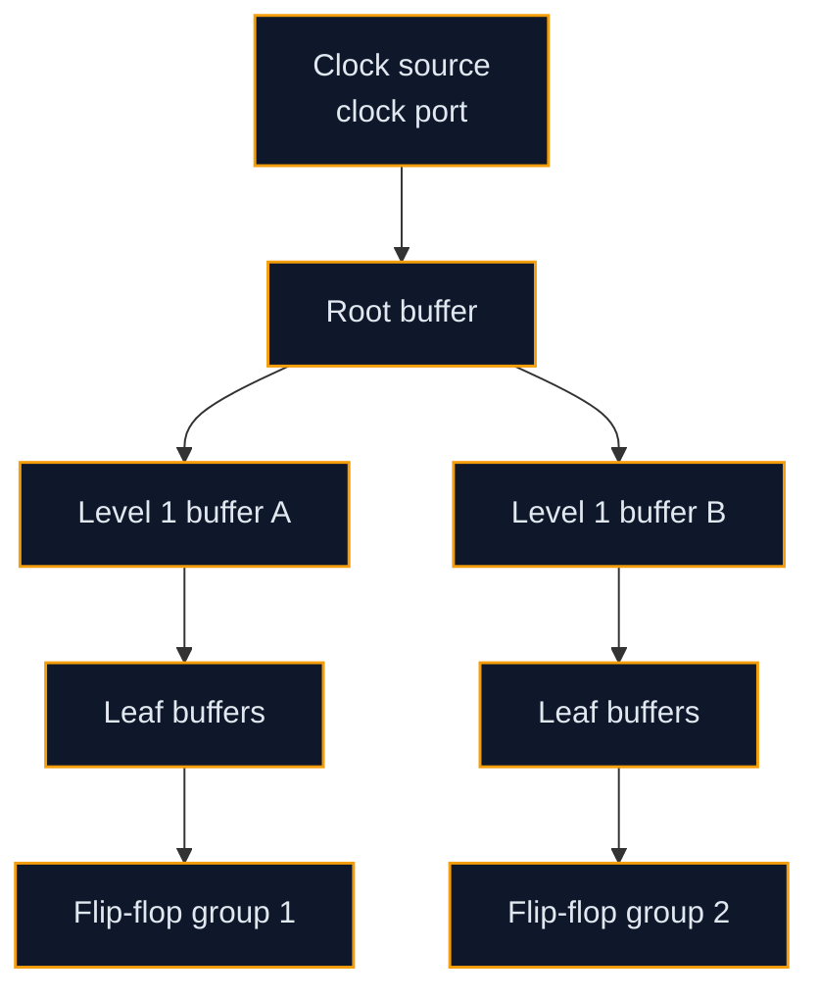

<div align="center">




<b>The physical design flow for a RISC-V SoC: a gate-level netlist is floorplanned, powered, placed, clocked, routed and verified with DRC and LVS, and finally written out as a GDSII layout database using an open-source toolchain.</b>

<br/>


<br/>

[Overview](#overview) |
[At a Glance](#project-at-a-glance) |
[Background](#background-from-netlist-to-layout) |
[Functions](#supported-functions) |
[Architecture](#architecture) |
[Stage Description](#stage-description) |
[Floorplan and Power](#floorplanning-and-power-planning-in-depth) |
[Placement and Clock](#placement-and-clock-tree-in-depth) |
[Routing](#routing-in-depth) |
[Signoff](#physical-verification-and-signoff) |
[Configuration](#flow-configuration) |
[Interface](#inputs-and-outputs) |
[Getting Started](#getting-started) |
[Verification](#verification-and-checks) |
[Troubleshooting](#troubleshooting) |
[FAQ](#faq) |
[License](#license)

</div>

---

## Overview

This project takes a **RISC-V SoC** from a **synthesized gate-level netlist** to a **GDSII layout database**. It covers the part of the ASIC flow that turns a logical description made of standard cells into a physical description made of polygons on metal and silicon layers: the geometry that a foundry would use to build the chip.

The flow starts from the **gate-level netlist** of the RISC-V SoC and its **standard cell library**. **Floorplanning** fixes the die and core area, the aspect ratio and the placement of any macros. **Power planning** builds the power network of rings, stripes and rails that delivers supply to every cell. **I/O and pin placement** assigns the chip interface to locations on the boundary. **Standard cell placement** puts every cell on the placement rows and then optimizes the result. **Clock tree synthesis (CTS)** builds a balanced buffer tree that distributes the clock to every flip-flop while controlling skew. **Global routing** plans the connections and estimates congestion, and **detailed routing** draws the actual metal wires and vias. **Physical verification** then checks the layout with **design rule checking (DRC)** and **layout versus schematic (LVS)**, and the final **GDSII** file is generated and reviewed.

The flow is driven by **OpenLane** with **OpenROAD** as the physical engine, **Yosys** for synthesis, **OpenSTA** for timing, **Magic** and **Netgen** for signoff checks and **KLayout** for viewing and checking the layout. Every stage is controlled by one configuration file and a small set of scripts, so the whole run is **repeatable**: the same inputs and settings always produce the same layout.

<table>
<tr>
<td width="50%" valign="top">

#### Objectives
- Take the gate-level netlist of a RISC-V SoC through a complete physical design flow
- Create a floorplan with a defined die area, core area and utilization
- Build a robust power grid with rings, stripes and rails
- Place the I/O pins and all standard cells legally and with good wire length
- Build a clock tree and analyze clock skew
- Route all signals with global and detailed routing and manage congestion
- Verify the layout with DRC and LVS
- Generate the final GDSII layout database and review it in a layout viewer

</td>
<td width="50%" valign="top">

#### Key Features
- Physical floorplanning
- Power grid planning
- Standard cell placement
- Clock tree synthesis
- Clock skew analysis
- Signal routing
- Routing congestion analysis
- DRC verification
- LVS verification
- Layout database generation

</td>
</tr>
</table>

---

## Project at a Glance

| Attribute | Detail |
|:--|:--|
| **Design type** | RISC-V RTL-to-GDSII physical design |
| **Input** | Gate-level netlist of the RISC-V SoC, timing constraints and standard cell libraries |
| **Main output** | Physical layout and GDSII database |
| **Implementation flow** | Floorplanning, power planning, placement, CTS, routing, physical verification |
| **Flow driver** | OpenLane |
| **Physical engine** | OpenROAD |
| **Synthesis** | Yosys |
| **Timing analysis** | OpenSTA |
| **Signoff checks** | DRC with Magic and KLayout, LVS with Netgen |
| **Layout viewing** | KLayout |
| **Technology** | An open PDK with its standard cell library, selected in the configuration (TBD) |
| **Clocking** | One main clock, distributed by a clock tree |
| **Configuration** | One `config.json` plus an optional constraints file |
| **Stages** | 10 (netlist input to GDSII generation) |
| **Reproducibility** | Fully scripted, one command per run |
| **Reports** | Area, utilization, timing, skew, congestion, DRC and LVS |
| **License** | MIT |

---

## Background: From Netlist to Layout

A synthesized netlist says **what** the chip is made of: which standard cells exist and how their pins are connected. It says nothing about **where** each cell sits, **how** the wires run, or **how** power and clock reach every gate. Physical design answers these questions and produces a layout that the foundry can manufacture.

Five ideas explain the flow.

**The floorplan sets the stage.** The chip is a rectangle. Inside it, the **core** holds the standard cell rows, and the ring between the core and the die edge holds the power ring and the pins. How large the core is, and how densely it is filled, decides how easy every later step will be.

**Power must reach every cell.** Every standard cell needs a supply and a ground connection. A **power distribution network** made of rings, vertical stripes and horizontal rails brings power from the pads or pins to every cell row. A weak network causes **IR drop**, where cells far from the supply see a lower voltage and run slower.

**Placement decides wire length.** Cells connected by many nets should sit close together. A placer minimizes total wire length while spreading cells so that no area is overfilled and no two cells overlap. Wire length drives delay, power and routing effort.

**The clock is special.** The clock net reaches every flip-flop, so it is very large and very sensitive. A **clock tree** of buffers is built so that the clock arrives at all flip-flops at nearly the same time. The difference in arrival times is the **skew**, and it must be small.

**Routing and verification close the loop.** The router connects every net with metal wires and vias on the available layers, obeying the **design rules** of the process. Then the layout is checked: **DRC** confirms that the geometry obeys the manufacturing rules, and **LVS** confirms that the layout implements exactly the netlist that was synthesized.

Together these steps produce the **GDSII** file, the standard exchange format for the layout geometry of an integrated circuit.

---

## Supported Functions

| Group | Function | Description |
|:--|:--|:--|
| **Floorplan** | `FLOORPLAN CREATION` | Defines die area, core area, aspect ratio and cell rows |
| **Power** | `POWER PLANNING` | Builds the power rings, stripes and rails |
| **Interface** | `I/O PIN PLACEMENT` | Assigns chip pins to locations on the boundary |
| **Placement** | `STANDARD CELL PLACEMENT` | Places all cells legally and optimizes wire length |
| **Clock** | `CLOCK TREE SYNTHESIS` | Builds a buffered tree that distributes the clock |
| **Clock** | `CLOCK DISTRIBUTION` | Delivers the clock to every sequential cell with controlled skew |
| **Routing** | `GLOBAL ROUTING` | Plans net paths and estimates congestion |
| **Routing** | `DETAILED ROUTING` | Draws the final metal wires and vias |
| **Signoff** | `DESIGN RULE CHECKING (DRC)` | Checks the layout against the process design rules |
| **Signoff** | `LAYOUT VS SCHEMATIC (LVS)` | Checks that the layout matches the netlist |

---

## Architecture

The flow is a pipeline. Each stage reads the database written by the previous stage, improves or extends it, and writes a new database and a set of reports. A stage can be run alone, which makes it easy to inspect and to repeat.

#### Flow diagram

```text
   INPUTS
   +----------------------------------------------------------------------+
   |  Gate-level netlist (RISC-V SoC)   SDC constraints   PDK + std cells |
   +-------------------------------------+--------------------------------+
                                         |
                                         v
   +----------------------------------------------------------------------+
   |  01 NETLIST INPUT       read netlist, libraries, constraints         |
   +-------------------------------------+--------------------------------+
                                         v
   +----------------------------------------------------------------------+
   |  02 FLOORPLANNING       die area, core area, rows, macro placement   |
   +-------------------------------------+--------------------------------+
                                         v
   +----------------------------------------------------------------------+
   |  03 POWER PLANNING      rings, stripes, rails, tap cells             |
   +-------------------------------------+--------------------------------+
                                         v
   +----------------------------------------------------------------------+
   |  04 I/O PIN PLACEMENT   pin locations on the boundary                |
   +-------------------------------------+--------------------------------+
                                         v
   +----------------------------------------------------------------------+
   |  05 CELL PLACEMENT      global placement, legalization, optimization |
   +-------------------------------------+--------------------------------+
                                         v
   +----------------------------------------------------------------------+
   |  06 CLOCK TREE SYNTHESIS  buffers, balancing, skew analysis          |
   +-------------------------------------+--------------------------------+
                                         v
   +----------------------------------------------------------------------+
   |  07 GLOBAL ROUTING      net guides, congestion estimate              |
   +-------------------------------------+--------------------------------+
                                         v
   +----------------------------------------------------------------------+
   |  08 DETAILED ROUTING    metal wires and vias, DRC-clean routes       |
   +-------------------------------------+--------------------------------+
                                         v
   +----------------------------------------------------------------------+
   |  09 PHYSICAL VERIFICATION   DRC checks, LVS checks                   |
   +-------------------------------------+--------------------------------+
                                         v
   +----------------------------------------------------------------------+
   |  10 GDSII GENERATION    stream out, final layout review              |
   +-------------------------------------+--------------------------------+
                                         |
                                         v
   OUTPUTS:  layout (DEF), GDSII, netlist with parasitics, timing, DRC and LVS reports
```

#### Data flow

```mermaid
flowchart LR
    NET["SYNTHESIZED NETLIST INPUT<br/>RISC-V SoC gate-level netlist, standard cell design, physical design input"] --> FP["FLOORPLANNING<br/>die area, core area, macro placement, initial floorplan"]
    FP --> PWR["POWER PLANNING<br/>power network design, power rings, power stripes, power grid"]
    PWR --> IO["I/O AND PIN PLACEMENT<br/>input and output pins, interface locations, pin assignment"]
    IO --> PLC["STANDARD CELL PLACEMENT<br/>gate-level netlist, cell placement, placement optimization"]
    PLC --> CTS["CLOCK TREE SYNTHESIS<br/>clock source, buffer insertion, clock distribution, skew analysis"]
    CTS --> GR["GLOBAL ROUTING<br/>net connectivity, routing estimation, congestion analysis"]
    GR --> DR["DETAILED ROUTING<br/>signal routing, metal interconnects, routed design"]
    DR --> PV["PHYSICAL VERIFICATION<br/>DRC checks, LVS checks, rule and connectivity validation"]
    PV --> GDS["GDSII GENERATION<br/>physical layout, final layout database, GDSII output"]

    classDef step fill:#0f172a,stroke:#f59e0b,color:#e2e8f0,stroke-width:1.5px;
    class NET,FP,PWR,IO,PLC,CTS,GR,DR,PV,GDS step;
```



#### Block breakdown

| No. | Block | Role | Main inputs | Main outputs |
|:-:|:--|:--|:--|:--|
| 01 | **Synthesized netlist input** | Loads the gate-level SoC netlist, libraries and constraints | Netlist, liberty files, SDC | Internal design database |
| 02 | **Floorplanning** | Defines die, core, rows and macro positions | Netlist area, utilization target | Floorplan DEF |
| 03 | **Power planning** | Builds the power network | Floorplan, PDN settings | Powered floorplan |
| 04 | **I/O and pin placement** | Assigns pins to the boundary | Port list, pin rules | Placed pins |
| 05 | **Standard cell placement** | Places and legalizes cells, optimizes timing | Netlist, floorplan | Placed DEF |
| 06 | **Clock tree synthesis** | Builds the clock distribution network | Clock net, sinks, buffers | Clocked DEF, skew report |
| 07 | **Global routing** | Plans routes, estimates congestion | Placed and clocked design | Route guides |
| 08 | **Detailed routing** | Draws wires and vias | Route guides, design rules | Routed DEF |
| 09 | **Physical verification** | Runs DRC and LVS | Layout, netlist | DRC and LVS reports |
| 10 | **GDSII generation** | Writes the final layout database | Verified layout | GDSII file |

> **Final design block:** the RISC-V SoC after floorplanning, placement, clocking and routing, with a clean physical verification result as the goal (result TBD).

---

## Stage Description

#### 01 Synthesized netlist input

The flow begins with the **gate-level netlist** produced by logic synthesis. The netlist instantiates **standard cells** from the technology library and connects them with nets. Three kinds of input are read together:

| Input | Purpose |
|:--|:--|
| **Gate-level netlist** | The list of cells and connections of the RISC-V SoC |
| **Liberty (`.lib`) timing libraries** | Delay, power and area data for every standard cell |
| **LEF files** | Abstract physical views of the cells: size, pin positions, metal layers |
| **SDC constraints** | Clock definition and input and output timing requirements |

Before any physical step, the netlist is checked for unmapped cells, missing modules and unconnected ports, because every later stage assumes a clean input.

#### 02 Floorplanning

Floorplanning decides the shape and size of the chip.

| Item | Meaning |
|:--|:--|
| **Die area** | The total silicon area of the chip, including the boundary |
| **Core area** | The inner area that holds the standard cell rows |
| **Utilization** | The fraction of the core area filled by cells |
| **Aspect ratio** | Height divided by width of the core |
| **Rows** | The horizontal strips on which standard cells are placed |
| **Macros** | Large blocks such as an SRAM that are placed before the cells |

A lower utilization leaves room for routing and timing optimization. A higher utilization saves area but makes routing harder. The target utilization is a configuration value (TBD).

#### 03 Power planning

The power network is built on the upper metal layers. It has a **power ring** around the core, **vertical and horizontal stripes** that form a grid, and **rails** along each cell row that touch the power pins of the cells. **Tap cells** and **end cap cells** are inserted to tie the wells to supply and to protect the row ends.

#### 04 I/O and pin placement

Every port of the SoC top level becomes a **pin** on the die boundary. Pins can be placed evenly, grouped by function, or fixed by a user file. Good pin placement shortens the wires between the pins and the logic that uses them.

#### 05 Standard cell placement

Placement happens in steps. **Global placement** spreads the cells and minimizes wire length with density control. **Legalization** snaps every cell to a row site and removes overlaps. **Placement optimization** repairs long wires and fixes timing and electrical problems by sizing cells and inserting buffers.

#### 06 Clock tree synthesis

The clock net is rebuilt as a **tree of clock buffers** that reaches every flip-flop. The aim is a small **skew** and a controlled **insertion delay**. After the tree is built, the timing is re-checked with the real clock arrival times instead of an ideal clock.

#### 07 Global routing

The router divides the die into a grid of **tiles** and plans which tiles each net will cross. It reports **congestion**: tiles where more wires are wanted than the layers can carry. Heavy congestion means the placement or the floorplan should change.

#### 08 Detailed routing

The detailed router turns the plan into real geometry: metal wires on specific tracks and vias between layers, obeying spacing, width and other rules. It iterates until no design rule violations remain, or reports the violations that it could not fix.

#### 09 Physical verification

Two checks decide whether the layout is correct. **DRC** examines the geometry against the process rules. **LVS** extracts the circuit from the layout and compares it with the netlist. An **antenna check** looks for long wires that can collect charge during manufacturing.

#### 10 GDSII generation

The final layout is **streamed out** to a **GDSII** file. The file is opened in **KLayout** for a visual review of the layers, the power grid, the pins and the routing.

---

## Floorplanning and Power Planning in Depth

#### Die and core area

The core area is derived from the synthesized cell area and the target utilization:

```text
core area  =  total standard cell area  /  target utilization
die area   =  core area  +  margin on every side for the power ring and the pins
```

| Parameter | Effect when increased |
|:--|:--|
| **Utilization** | Smaller chip, harder routing, less room for repair buffers |
| **Aspect ratio** | Taller or wider core; affects wire length and pin placement |
| **Core margin** | More room for the power ring and pins, larger die |

The values chosen for this design are recorded in the configuration and in the reports (TBD).

#### Macro placement

Large blocks such as an SRAM macro are placed before the standard cells. A macro should sit near the edge, away from the center of the logic, with its pins facing the logic that uses them. A **halo** keeps cells and wires away from the macro boundary. If the SoC uses a behavioral memory made of flip-flops instead of a macro, this step has nothing to place (TBD for this design).

#### Power network structure

| Element | Layer type | Role |
|:--|:--|:--|
| **Power ring** | Upper metals | Encircles the core and collects supply from the pins |
| **Vertical stripes** | Upper metal, vertical | Carry supply down into the core |
| **Horizontal stripes** | Upper metal, horizontal | Cross the vertical stripes to form a grid |
| **Standard cell rails** | Lowest metal | Run along each row and touch the cell power pins |
| **Vias** | Between layers | Connect rails, stripes and rings into one network |

The stripe **pitch** and **width** set the resistance of the network. A denser grid lowers IR drop but uses more routing resources on the upper layers.

#### Tap cells and end caps

**Tap cells** are placed at regular intervals along every row to connect the wells to the supply and prevent latch-up. **End cap cells** terminate each row so that the cells at the row ends see the same environment as the cells inside the row.

#### Power checks

| Check | What it looks for |
|:--|:--|
| **Connectivity** | Every cell power pin connects to the grid |
| **IR drop** | The voltage seen by the farthest cell stays inside the allowed range (TBD) |
| **Electromigration** | Current density in supply wires stays below the limit |

---

## Placement and Clock Tree in Depth

#### Placement stages


| Stage | Goal |
|:--|:--|
| **Global placement** | Low total wire length with controlled cell density |
| **Resizing and buffering** | Fix max slew, max capacitance and long wire problems |
| **Legalization** | Every cell on a valid site, no overlap |
| **Detailed placement** | Small moves that improve wire length without breaking legality |
| **Timing check** | Estimate setup and hold slack with placement-based parasitics |

#### Placement density

The **target density** controls how tightly global placement packs the cells. A high density gives short wires but risks congestion. A low density spreads the cells and eases routing but lengthens wires. The balance depends on the design and is tuned from the congestion and timing reports (TBD).

#### Clock tree synthesis



| Term | Meaning |
|:--|:--|
| **Sink** | A clock pin of a flip-flop, latch or macro |
| **Insertion delay** | Time from the clock source to a sink |
| **Skew** | Difference in clock arrival time between two sinks |
| **Clock buffer** | A buffer or inverter cell chosen for the clock tree |
| **Clustering** | Grouping nearby sinks so that each buffer drives a limited load |
| **Balancing** | Making the path delay to all sinks nearly equal |

#### Why skew matters

Skew moves the effective capture time of a flip-flop. Positive skew on the capture side helps setup but hurts hold. Negative skew does the opposite. The goal of CTS is therefore not zero skew at any cost, but a **small and controlled** skew with all setup and hold checks still passing.

| Skew effect | Setup check | Hold check |
|:--|:--|:--|
| Capture clock later than launch clock | Gains margin | Loses margin |
| Capture clock earlier than launch clock | Loses margin | Gains margin |

#### Clock analysis outputs

| Output | Use |
|:--|:--|
| **Clock skew report** | Worst skew across all sinks (TBD) |
| **Insertion delay report** | Latency of the tree (TBD) |
| **Clock buffer count** | Cost of the tree in area and power (TBD) |
| **Post-CTS timing report** | Setup and hold slack with real clock arrivals (TBD) |

Hold violations that appear after CTS are repaired by inserting delay buffers on the short paths.

---

## Routing in Depth

#### Global routing

Global routing works on a coarse grid. It decides, for every net, which grid cells (**GCells**) the wire will pass through and on which layers. It does not draw the wire; it creates **route guides** that the detailed router must follow.

| Concept | Meaning |
|:--|:--|
| **GCell** | One tile of the routing grid |
| **Capacity** | Number of wire tracks a GCell edge can carry |
| **Demand** | Number of wires that want to cross that edge |
| **Overflow** | Demand above capacity, a sign of congestion |
| **Route guide** | The corridor of GCells assigned to a net |

#### Congestion analysis

Congestion is read from the global routing report and from a congestion map in the viewer. A few hot spots can be solved by detailed routing. Widespread overflow means a change is needed earlier in the flow.

| Symptom | Likely cause | Typical remedy |
|:--|:--|:--|
| Overflow near the center | Utilization or density too high | Lower utilization or placement density |
| Overflow near macros | Pins blocked by halos or macro placement | Move the macro, adjust the halo |
| Overflow along one edge | Pin placement concentrates nets | Spread or regroup pins |
| Overflow on a few layers | Layer adjustments or reserved tracks | Revise layer capacity settings |

#### Detailed routing

The detailed router assigns each wire segment to an exact **track** on a **metal layer** and adds **vias** to change layers. It follows these rules:

| Rule | Meaning |
|:--|:--|
| **Minimum width** | Narrowest legal wire on a layer |
| **Minimum spacing** | Smallest legal gap between two shapes |
| **Via enclosure** | Metal that must surround a via |
| **Preferred direction** | Each layer is mostly horizontal or mostly vertical |
| **Minimum area** | Smallest legal metal shape |

The router works in iterations. Each iteration removes violations from the previous one. The run ends when the **violation count reaches zero** or stops improving (TBD for this design).

#### Layer usage

| Layer group | Typical use |
|:--|:--|
| **Lowest metal** | Cell-level connections and power rails |
| **Middle metals** | Most signal routing |
| **Upper metals** | Power grid, clock and long signals |

#### Antenna effects

During manufacturing, long metal wires connected to a transistor gate can collect charge and damage the gate oxide. The antenna check finds these wires. The flow fixes them by **inserting diodes** near the gate or by **breaking the wire with a jumper** on a higher layer.

#### Routing results to record

| Metric | Value |
|:--|:-:|
| Total wire length | `TBD` |
| Via count | `TBD` |
| Global routing overflow | `TBD` |
| Detailed routing violations at the end | `TBD` |
| Antenna violations | `TBD` |

---

## Physical Verification and Signoff

#### Design rule checking (DRC)

DRC checks the layout geometry against the **design rules** of the process: widths, spacings, enclosures, densities and many more. The flow runs DRC with **Magic** and can also run the **KLayout** DRC deck for a second opinion.

| Result | Meaning |
|:--|:--|
| **Zero violations** | The layout obeys the checked rules |
| **Violations reported** | Geometry that breaks a rule; each has a location and a rule name |

A DRC violation is located in the viewer, traced to the cause (a routing issue, a macro issue or a cell issue) and fixed in the flow settings or in the design.

#### Layout versus schematic (LVS)

LVS extracts a circuit from the layout (devices and connections) and compares it with the netlist from synthesis. The tool **Netgen** performs the comparison.

| LVS finding | Meaning |
|:--|:--|
| **Circuits match** | The layout implements the netlist |
| **Device mismatch** | A device is missing, extra or has different parameters |
| **Net mismatch** | Two nets are shorted or one net is open |
| **Pin mismatch** | A top-level port differs between layout and netlist |

#### Other signoff checks

| Check | Purpose |
|:--|:--|
| **Antenna check** | Detects charge accumulation risks on long wires |
| **Static timing analysis** | Re-checks setup and hold with extracted parasitics |
| **Power grid analysis** | Looks at IR drop and connectivity of the supply network |
| **XOR check** | Compares two layout versions to confirm that only intended differences exist |

#### Signoff status table

| Check | Tool | Result |
|:--|:--|:-:|
| DRC | Magic / KLayout | `TBD` |
| LVS | Netgen | `TBD` |
| Antenna | OpenROAD / Magic | `TBD` |
| Setup timing | OpenSTA | `TBD` |
| Hold timing | OpenSTA | `TBD` |

#### GDSII generation and layout review

The final layout is written with **stream out** to a **GDSII** file. In **KLayout**, the review covers:

| Review item | What to look at |
|:--|:--|
| **Boundary** | The die and core outline and the pin locations |
| **Power grid** | Rings, stripes and rails, and their connections |
| **Cell rows** | Even placement and tap cell spacing |
| **Clock network** | The clock buffers and the wires of the tree |
| **Routing layers** | Each metal layer on its own, to check direction and density |
| **Macros** | Position, halo and pin access |
| **Fill and density** | Metal density across the die, where the process requires fill |

---

## Flow Configuration

#### The OpenLane configuration file

All settings of a run live in one `config.json`. The names below are common examples; exact names depend on the OpenLane version that is used.

```json
{
    "DESIGN_NAME": "soc_top",
    "VERILOG_FILES": "dir::src/soc_top.v",
    "CLOCK_PORT": "clk",
    "CLOCK_PERIOD": "TBD",
    "FP_CORE_UTIL": "TBD",
    "FP_ASPECT_RATIO": 1,
    "PL_TARGET_DENSITY": "TBD",
    "FP_PDN_VPITCH": "TBD",
    "FP_PDN_HPITCH": "TBD",
    "FP_IO_MODE": 1,
    "RT_MAX_LAYER": "TBD",
    "RUN_CTS": 1,
    "RUN_LVS": 1,
    "RUN_MAGIC_DRC": 1
}
```

Replace every `TBD` with the value chosen for the design before running the flow.

#### Stages and tools

| Stage | Tool | Main outputs |
|:--|:--|:--|
| **Synthesis** | Yosys | Mapped netlist |
| **Static timing** | OpenSTA | Timing reports at each stage |
| **Floorplanning** | OpenROAD | Floorplan DEF, rows, tap cells |
| **Power planning** | OpenROAD | Power grid |
| **I/O placement** | OpenROAD | Pin locations |
| **Placement** | OpenROAD | Placed DEF |
| **Clock tree synthesis** | OpenROAD (TritonCTS) | Clock tree, skew report |
| **Global routing** | OpenROAD (FastRoute) | Route guides |
| **Detailed routing** | OpenROAD (TritonRoute) | Routed DEF |
| **Parasitic extraction** | OpenROAD / Magic | Parasitic data |
| **DRC** | Magic, KLayout | DRC report |
| **LVS** | Netgen | LVS report |
| **Stream out** | Magic or KLayout | GDSII file |

#### Key configuration groups

| Group | Example settings | What they control |
|:--|:--|:--|
| **Design** | Name, source files, top module | What is built |
| **Clock** | Clock port, period | Timing target |
| **Floorplan** | Utilization, aspect ratio, margins | Chip size and shape |
| **Power** | Pitch, width, offset of stripes | Power grid density |
| **Pins** | Placement mode, pin file | Pin positions |
| **Placement** | Target density, timing-driven option | Spreading versus wire length |
| **CTS** | Buffer list, cluster size, cluster diameter | Clock tree shape |
| **Routing** | Max routing layer, layer adjustments | Route resources |
| **Signoff** | Run DRC, run LVS, run antenna check | Checks to execute |

#### PDK and standard cell library

A **process design kit (PDK)** provides everything the flow needs to know about a manufacturing process: layer definitions, design rules, device models, extraction rules and the **standard cell library**. The library supplies cells such as inverters, NAND and NOR gates, multiplexers, flip-flops and clock buffers, each with a **liberty** timing view, a **LEF** physical view and a **GDS** layout view.

| File type | Content |
|:--|:--|
| **Liberty (`.lib`)** | Timing, power and area of each cell |
| **LEF (`.lef`)** | Cell size, pin shapes, layer and via definitions |
| **GDS (`.gds`)** | The polygon layout of each cell |
| **Tech file** | Layer stack and rules for the layout tools |
| **DRC and LVS decks** | Rule files for the signoff tools |

The PDK and library used for this design are set in the configuration (TBD).

---

## Inputs and Outputs

#### Inputs

| Input | Format | Description |
|:--|:--|:--|
| **Gate-level netlist** | Verilog | Synthesized RISC-V SoC |
| **Timing constraints** | SDC | Clock and I/O delays |
| **Standard cell timing** | Liberty | Cell delay and power |
| **Standard cell physical data** | LEF | Cell geometry |
| **Technology data** | Tech LEF and rule decks | Layers and rules |
| **Configuration** | JSON | Flow settings |
| **Pin constraints** | Optional file | Fixed pin positions |
| **Macro data** | Optional LEF, GDS and liberty | Memories or other blocks |

#### Outputs

| Output | Format | Description |
|:--|:--|:--|
| **Layout database** | DEF | Placed and routed design |
| **Final layout** | GDSII | Geometry for manufacturing |
| **Final netlist** | Verilog | Netlist after physical optimization |
| **Parasitics** | SPEF | Extracted wire resistance and capacitance |
| **Timing reports** | Text | Setup, hold, slack and skew |
| **Area and utilization report** | Text | Die, core and cell area |
| **DRC report** | Text | Rule violations |
| **LVS report** | Text | Netlist comparison result |
| **Logs** | Text | One log per stage |

#### Parameters to choose

| Parameter | Description | Value |
|:--|:--|:-:|
| Clock period | Target clock period | `TBD` |
| Core utilization | Fraction of the core filled by cells | `TBD` |
| Aspect ratio | Core height to width | `TBD` |
| Placement density | Target density in global placement | `TBD` |
| PDN pitch | Spacing of the power stripes | `TBD` |
| Max routing layer | Highest metal layer used for signals | `TBD` |

---

## Run Sequence

```text
Step  Action
----  ---------------------------------------------------------------
 1    Read the netlist, libraries and constraints
 2    Create the floorplan and the cell rows
 3    Insert tap cells and end caps
 4    Build the power grid
 5    Place the I/O pins
 6    Run global placement, then legalize and optimize
 7    Build the clock tree and repair hold violations
 8    Run global routing and read the congestion report
 9    Run detailed routing until the violation count stops falling
10    Extract parasitics and run signoff timing
11    Run DRC, LVS and the antenna check
12    Stream out the GDSII file and review it in the viewer
```

Each step writes a database and a report, so the flow can be stopped, inspected and resumed.

---

## Repository Structure

```text
risc-v-rtl-to-gdsii-physical-design/
├── src/
│   └── soc_top.v               # Gate-level or RTL source of the RISC-V SoC
├── constraints/
│   ├── design.sdc              # Clock and I/O timing constraints
│   └── pin_order.cfg           # Optional pin placement file
├── config.json                 # OpenLane flow configuration
├── scripts/
│   ├── run_flow.sh             # Runs the complete flow
│   ├── run_stage.sh            # Runs one stage
│   ├── extract_reports.py      # Collects key metrics from the reports
│   └── view_layout.sh          # Opens the final GDSII in KLayout
├── runs/
│   └── latest/                 # Generated results of the last run
│       ├── logs/               # One log per stage
│       ├── reports/            # Timing, area, congestion, DRC and LVS reports
│       ├── results/            # DEF, netlist, SPEF and GDSII
│       └── tmp/                # Temporary files
├── docs/
│   └── layout_review.md        # Notes from the layout review
├── LICENSE
└── README.md
```

---

## Technology Stack

| Category | Tool or item | Purpose |
|:--|:--|:--|
| **Design language** | SystemVerilog or Verilog | RISC-V SoC source |
| **Flow driver** | OpenLane | Runs the complete RTL-to-GDSII flow |
| **Physical engine** | OpenROAD | Floorplan, placement, CTS and routing |
| **Synthesis** | Yosys | Logic synthesis and technology mapping |
| **Timing** | OpenSTA | Static timing analysis |
| **DRC and extraction** | Magic | Design rule checks, extraction, stream out |
| **LVS** | Netgen | Netlist comparison |
| **Layout viewer** | KLayout | Layout inspection and checks |
| **Constraints** | SDC | Timing constraints |
| **Technology** | Open PDK with standard cell library | Process rules and cells |
| **Scripting** | Bash and Python | Automation and report collection |
| **Layout format** | DEF, GDSII | Physical design exchange formats |

---

## Getting Started

#### Prerequisites

| Item | Notes |
|:--|:--|
| **Operating system** | Linux is recommended |
| **Container runtime** | Docker, used by the standard OpenLane setup |
| **OpenLane** | Installed with its tools and a PDK |
| **KLayout** | For viewing the final layout |
| **Python 3** | For the report scripts |
| **Disk space and memory** | A full run needs several gigabytes of disk and a few gigabytes of memory |

#### 1. Clone

```bash
git clone https://github.com/dhruvalmistry2007/risc-v-rtl-to-gdsii-physical-design.git
cd risc-v-rtl-to-gdsii-physical-design
```

#### 2. Check the configuration

```bash
# Open config.json and replace every TBD with the value chosen for the design
nano config.json
```

#### 3. Run the complete flow

```bash
# OpenLane 2 style
openlane config.json

# Classic OpenLane style
./flow.tcl -design risc-v-rtl-to-gdsii-physical-design
```

The command that applies depends on the OpenLane version that is installed. Follow the OpenLane documentation for that version.

#### 4. Read the reports

```bash
# Collect key metrics from the run
python3 scripts/extract_reports.py runs/latest/reports
```

#### 5. View the layout

```bash
klayout runs/latest/results/final/gds/soc_top.gds
```

#### 6. Run a single stage

```bash
# Example: rerun placement after changing the placement density
./scripts/run_stage.sh placement
```

---

## Verification and Checks

Physical design is verified at every stage, not only at the end. A problem found at placement costs minutes; the same problem found after routing can cost the whole run.


#### Check plan

| ID | Stage | Check | Pass condition |
|:-:|:--|:--|:--|
| C01 | Input | Netlist contains only library cells and the top module is found | No unresolved references |
| C02 | Input | Constraints load without errors | Clock defined on the clock port |
| C03 | Floorplan | Core area and utilization match the target | Within the set tolerance (TBD) |
| C04 | Floorplan | Cell rows and tap cells present | Tap cells at the specified spacing |
| C05 | Power | All cell power pins connect to the grid | No floating supply pins |
| C06 | Pins | Every port has a pin on the boundary | Pin count equals port count |
| C07 | Placement | No overlapping cells, all on valid sites | Zero overlap |
| C08 | Placement | Placement density within the limit | No overfilled regions |
| C09 | Placement | Max slew, capacitance and fanout limits | No violations after repair |
| C10 | CTS | All flip-flops reached by the clock tree | Sink count equals flip-flop count |
| C11 | CTS | Clock skew inside the target | Skew within the limit (TBD) |
| C12 | CTS | Setup and hold after CTS | Slack not negative (TBD) |
| C13 | Global route | Overflow | Zero or near zero (TBD) |
| C14 | Detailed route | Violations at the end of routing | Zero (TBD) |
| C15 | Signoff | DRC | Zero violations (TBD) |
| C16 | Signoff | LVS | Circuits match (TBD) |
| C17 | Signoff | Antenna | Zero violations after repair (TBD) |
| C18 | Signoff | Final setup and hold with extracted parasitics | Slack not negative (TBD) |
| C19 | Output | GDSII file exists and opens in the viewer | File loads without errors |

#### Timing checks in detail

| Check | Equation or idea |
|:--|:--|
| **Setup slack** | Required time minus arrival time of the data at the capture flip-flop |
| **Hold slack** | Arrival time of the new data minus the hold requirement at the capture flip-flop |
| **Worst negative slack (WNS)** | The most negative slack among all paths |
| **Total negative slack (TNS)** | The sum of all negative slacks |
| **Critical path** | The path with the smallest setup slack |

Timing is analyzed at several points: after synthesis with an ideal clock, after placement with estimated wires, after CTS with the real clock tree, and after routing with extracted parasitics. The numbers are expected to **get worse and more realistic** at each point.

#### Timing result table

| Point | WNS | TNS |
|:--|:-:|:-:|
| After synthesis | `TBD` | `TBD` |
| After placement | `TBD` | `TBD` |
| After CTS | `TBD` | `TBD` |
| After routing | `TBD` | `TBD` |

#### Area and utilization result table

| Metric | Value |
|:--|:-:|
| Die area | `TBD` |
| Core area | `TBD` |
| Standard cell area | `TBD` |
| Core utilization | `TBD` |
| Cell count | `TBD` |
| Sequential cell count | `TBD` |
| Clock buffer count | `TBD` |

#### Power result table

| Metric | Value |
|:--|:-:|
| Internal power | `TBD` |
| Switching power | `TBD` |
| Leakage power | `TBD` |
| Total power | `TBD` |

#### Layout review checklist

- Die and core outline are as intended
- Power ring is closed and connected to the pins
- Stripes and rails form a continuous grid
- Tap cells appear in every row at regular spacing
- Pins are on the boundary and labeled with the right names
- The clock tree wires are visible and symmetric where expected
- No cell sits outside the core
- Routing density looks even; no empty or packed regions without reason
- Macros, if any, are clear of cells and have access to their pins
- The GDSII top cell name matches the design name

---

## Design Considerations

| Topic | Consideration |
|:--|:--|
| **Utilization and routability** | Start with a moderate utilization; raise it only when routing stays clean |
| **Clock period** | A very tight clock period makes placement and CTS work harder and increases area and power |
| **Memory** | A memory built from flip-flops is large; a macro from a memory generator saves area but needs macro placement and extra views |
| **Power grid density** | A denser grid lowers IR drop but takes routing resources |
| **Pin placement** | Pins that are far from the logic that uses them lengthen wires and add congestion |
| **Hold fixing** | Hold repair adds delay buffers, which adds area and power |
| **Fill and density rules** | Some processes require metal fill, which affects the final database |
| **Reproducibility** | Keep the configuration, tool versions and PDK version with the results |
| **Runtime** | Larger designs take longer; use stage-by-stage runs while tuning |

#### Current limitations

- The flow uses an open-source toolchain and an open PDK; results are not comparable to a commercial signoff flow
- The design is an academic physical design exercise and has not been fabricated
- Signoff coverage is limited to the checks in the flow; no multi-corner or on-chip variation study is included
- Power analysis uses default switching activity unless activity data is provided
- A behavioral memory is built from standard cells; no custom memory macro is used (TBD)
- IR drop and electromigration analysis are basic

---

## Applications

| Area | Use |
|:--|:--|
| **ASIC physical design training** | A complete worked example of the flow from netlist to layout |
| **Open-source silicon projects** | A base flow that can be adapted to a small SoC |
| **Design-space exploration** | Trade area, timing and power by changing utilization, density and clock period |
| **Research** | A reproducible baseline for placement, CTS and routing experiments |
| **Education** | Teaches the meaning of every physical design report |
| **Portfolio** | Shows end-to-end understanding from RTL to layout |

---

## Customization

#### Change the clock period

Edit `CLOCK_PERIOD` in `config.json` and rerun. A shorter period tightens timing and increases the effort of placement, CTS and repair. Compare the setup slack before and after.

#### Change the floorplan

Edit `FP_CORE_UTIL` and `FP_ASPECT_RATIO`. Lower utilization gives more room; a different aspect ratio changes the wire length and the pin layout. Compare the congestion reports of the runs.

#### Change the power grid

Edit the stripe pitch and width settings. Compare IR drop and routing congestion of the upper layers.

#### Change the pin placement

Use the pin placement option, or provide a pin file with the side and order of each pin group.

#### Add a macro

Provide the macro LEF, liberty and GDS files in the configuration, give its location and a halo, and rerun from floorplanning.

#### Use a different PDK

Select another PDK and its standard cell library in the configuration. Review the layer names, the clock buffer list and the power pin names because these differ from one library to another.

#### Tune the clock tree

Adjust the clock buffer list, the cluster size and the cluster diameter. Compare skew, buffer count and hold repair effort.

---

## Troubleshooting

| Problem | Likely cause | What to do |
|:--|:--|:--|
| The flow stops at synthesis | Missing module or syntax problem in the source | Read the Yosys log, fix the source or the file list |
| Floorplan is too small | Utilization too high for the cell area | Lower the utilization |
| Power pins not connected | Wrong power net names or grid settings | Check the power and ground net names in the configuration |
| Placement fails with overflow | Density or utilization too high | Lower the density, lower the utilization |
| Many setup violations | Clock period too tight, long paths | Relax the period, enable timing-driven placement, revisit synthesis |
| Hold violations after CTS | Skew or very short paths | Run hold repair; check the clock tree balance |
| Large clock skew | Poorly clustered sinks or buffer selection | Tune cluster size and buffer list |
| Global routing overflow | Congestion | Lower utilization, spread pins, change layer settings |
| Detailed routing does not converge | Dense regions, difficult pin access | Lower utilization, check macro halos |
| DRC violations | Routing or cell issue | Locate each violation in the viewer, read its rule name, change settings |
| LVS mismatch | Missing power connection, shorted net, black box | Read the LVS log, check power nets and macro views |
| Antenna violations | Long wires on gate nets | Enable diode insertion or antenna repair |
| GDSII fails to open | Incomplete stream out | Check the stream out log and rerun the last stage |
| Different result on every run | Tool versions or settings changed | Pin the tool and PDK versions and keep the configuration under version control |

---

## FAQ

**What is the difference between DEF and GDSII?**
DEF describes the placement and routing of the design using references to cells and wires. GDSII is the final polygon database of the full layout. DEF is used inside the flow; GDSII goes to the foundry or to the layout viewer.

**What is utilization?**
The ratio of the standard cell area to the core area. A value of 50 percent means that half of the core area holds cells and the rest is free space for routing and optimization.

**Why is a power grid needed if cells have rails?**
Rails are thin, so their resistance is high. The stripes and rings bring supply into the core with much lower resistance and reduce IR drop.

**What is clock skew and is zero skew the goal?**
Skew is the difference in clock arrival time between two flip-flops. The goal is small and controlled skew, not always zero, because skew also affects the hold and setup margins.

**What is the difference between global and detailed routing?**
Global routing plans which regions a net passes through and estimates congestion. Detailed routing draws the real wires on exact tracks and obeys the design rules.

**What does DRC check?**
It checks the geometry of the layout against the manufacturing rules of the process, such as width, spacing and enclosure.

**What does LVS check?**
It checks that the circuit extracted from the layout is the same as the netlist: same devices and same connections.

**Why does the netlist change after physical design?**
The flow inserts buffers, resizes cells, adds clock cells, tap cells and antenna diodes. The final netlist reflects these changes.

**Why must timing be checked again after routing?**
Real wires add resistance and capacitance that were only estimated before. The extracted parasitics give the true delays.

**What is a tap cell?**
A cell that ties the wells of the process to the supply at regular spacing. It prevents latch-up.

**Why are there several metal layers?**
Layers let wires cross without touching and let long wires use thicker, lower resistance metal.

**Can the design be fabricated from this GDSII?**
This project is a physical design exercise. A real fabrication needs a foundry agreement, a full signoff flow, I/O pads and extra checks that are not part of this project.

**Can I use another standard cell library or PDK?**
Yes. Change the PDK settings in the configuration and review the layer names, clock buffers and power net names.

**How do I know a run is repeatable?**
Keep the tool versions, the PDK version and the configuration file. The same inputs should give the same outputs.

**What should I do first if a run fails?**
Open the log of the failing stage, read the first error, not the last, and fix that one first.

---

## Learning Outcomes

- Understand the stages of an RTL-to-GDSII flow and the data passed between them
- Create a floorplan and choose a utilization and aspect ratio with reasons
- Design a power grid and understand IR drop
- Place pins and standard cells and read placement reports
- Explain clock tree synthesis, skew and insertion delay
- Read global routing congestion reports and respond to them
- Understand detailed routing rules and the meaning of DRC violations
- Explain what LVS compares and how to read a mismatch
- Review a GDSII file layer by layer in a layout viewer
- Write a configuration file and automate a reproducible flow with scripts

---

## Glossary

| Term | Meaning |
|:--|:--|
| **ASIC** | Application-specific integrated circuit |
| **PDK** | Process design kit, the data that describes a manufacturing process |
| **Standard cell** | A pre-designed logic gate or flip-flop of fixed height |
| **LEF** | Library exchange format, the abstract physical view of cells |
| **DEF** | Design exchange format, the placed and routed design |
| **GDSII** | Layout database format of polygons on layers |
| **SDC** | Synopsys design constraints, the timing constraints format |
| **SPEF** | Standard parasitic exchange format |
| **CTS** | Clock tree synthesis |
| **DRC** | Design rule checking |
| **LVS** | Layout versus schematic |
| **IR drop** | Voltage loss across the resistance of the power network |
| **Skew** | Difference in clock arrival times |
| **Slack** | Margin between required time and arrival time |
| **WNS / TNS** | Worst negative slack and total negative slack |
| **Utilization** | Share of the core area filled with cells |
| **Halo** | A keep-out region around a macro |
| **Via** | A vertical connection between two metal layers |
| **Tap cell** | A cell that connects the wells to the supply |
| **Antenna effect** | Charge accumulation on long wires during manufacturing |

---

## Design Flow


<div align="center">

`NETLIST` | `FLOORPLAN` | `POWER GRID` | `PLACEMENT` | `CLOCK TREE` | `ROUTING` | `PHYSICAL VERIFICATION` | `GDSII`

</div>

---

## Future Work

- Add an SRAM macro from a memory generator and place it with a halo
- Run multi-corner timing analysis for setup and hold
- Add I/O pads and a pad ring for a complete chip
- Add metal fill and a full density check
- Add power analysis with real switching activity from simulation
- Add a more detailed IR drop and electromigration analysis
- Explore the effect of utilization, density and clock period in an automated sweep
- Try a second open PDK and compare the results
- Add an XOR check between runs to confirm repeatability
- Automate the flow in continuous integration with a report summary

---

## Contributing

Suggestions and improvements are welcome. Open an issue to discuss a change, or submit a pull request with a clear description of what it does and the reports that support it.

---

## References

- [OpenLane](https://github.com/The-OpenROAD-Project/OpenLane): open-source RTL-to-GDSII flow
- [OpenROAD](https://theopenroadproject.org/): open-source physical design tools
- [Yosys Open SYnthesis Suite](https://yosyshq.net/yosys/): open-source RTL synthesis framework
- [OpenSTA](https://github.com/The-OpenROAD-Project/OpenSTA): open-source static timing analyzer
- [Magic VLSI](http://opencircuitdesign.com/magic/): layout editor and DRC tool
- [Netgen](http://opencircuitdesign.com/netgen/): LVS tool
- [KLayout](https://www.klayout.de/): layout viewer and editor
- [SkyWater open PDK documentation](https://skywater-pdk.readthedocs.io/): example open process design kit
- Weste and Harris: CMOS VLSI Design, a circuits and systems perspective
- Sapatnekar: Timing, and Kahng, Lienig, Markov and Hu: VLSI Physical Design, From Graph Partitioning to Timing Closure

---

## License

This project is licensed under the **MIT License**. See the [LICENSE](LICENSE) file for details.

---

## Author

<div align="center">

**Dhruval Mistry**

[](https://github.com/dhruvalmistry2007)

<br/>


</div>
